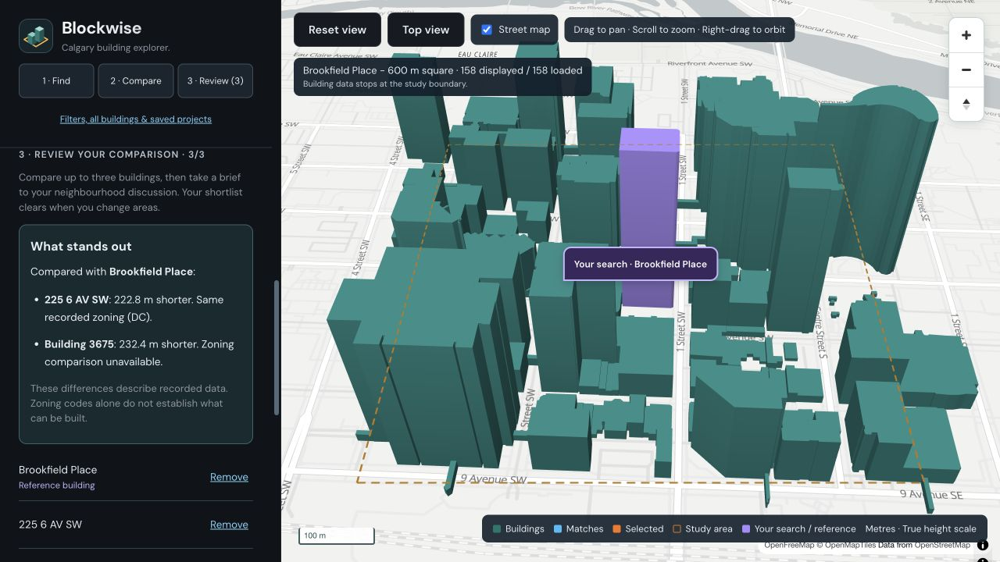
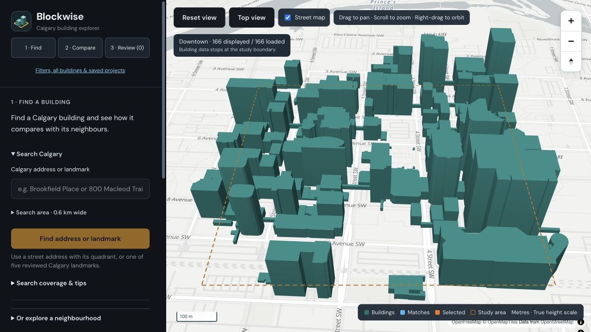
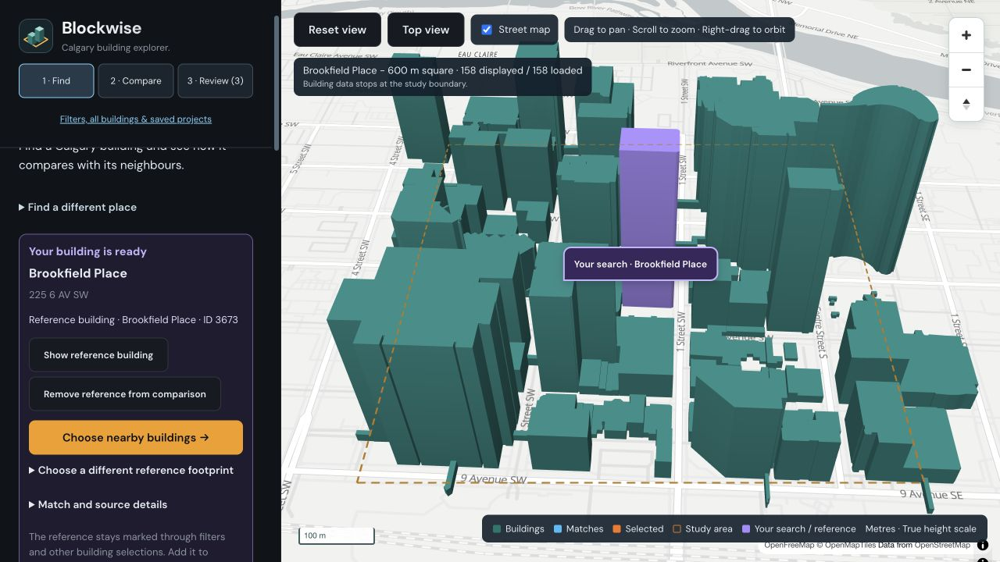
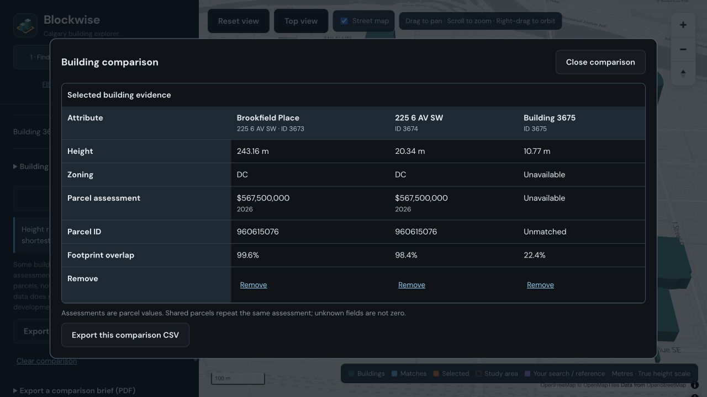
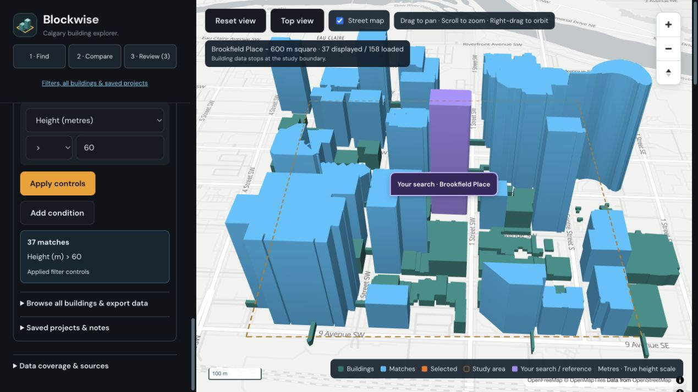
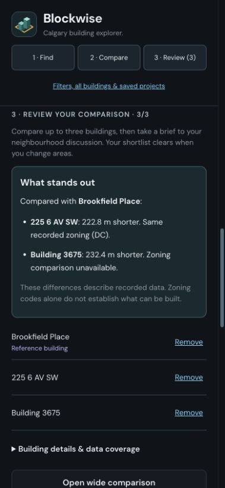

# Blockwise

### Find a Calgary building. Compare its neighbours. Understand the differences.

Blockwise turns Calgary's public building and property data into an interactive 3D explorer. Search for an address or a familiar landmark, identify your building, and compare it with nearby buildings—all in one map-based workspace.

Built as a personal project for **community planning volunteers, urban-design and architecture students, and curious Calgary residents**, Blockwise helps turn a neighbourhood question into a small, source-backed comparison that can be shared in a discussion.



[Interface tour](#interface-tour) · [Features](#what-you-can-do) · [Run locally](#local-setup) · [Deployment](#production-and-hosting) · [Tests](#verification)

## Why Blockwise?

A building is easier to understand in context. How tall is it compared with its neighbours? Do their recorded zoning codes differ? Which property details are available, and where does the data come from?

Blockwise brings the map, comparison, and evidence together. Its **Find → Compare → Review** workflow keeps the first task simple, while expandable tools support more detailed filtering and analysis.

## What you can do

| Capability | How it helps |
|---|---|
| **Explore in 3D** | Pan, orbit, tilt, and switch to a north-up top view. Building footprints and recorded heights sit on a continuous street basemap. |
| **Find an address or landmark** | Search City parcel addresses or five reviewed landmarks: Brookfield Place, The Bow, Calgary Tower, Suncor Energy Centre, and The CORE Shopping Centre. Common aliases are supported. |
| **Keep your place in view** | A persistent purple pin marks the search location; a reference footprint stays highlighted while you inspect other buildings or apply filters. Ambiguous matches ask you to choose. |
| **Compare nearby buildings** | Start with your reference and two nearby buildings, or choose your own shortlist of up to three. Suggestions show approximate distance and flag shared recorded parcels. |
| **Understand the differences** | Read plain-language height and zoning comparisons, then expand the evidence or open a wide table for details. |
| **Filter and investigate** | Use height, zoning, address, stage, and parcel-assessment filters, combine conditions with AND/OR, or enter a supported plain-language question. Search and sort loaded results. |
| **Review data coverage** | Inspect height distributions, zoning breakdowns, missing fields, parcel-overlap evidence, and source links. |
| **Save an analysis** | Save filters, study areas, notes, and manual reference choices under a username; reopen, rename, or delete projects later. |
| **Share the evidence** | Export a PDF comparison brief, comparison/results CSV, or analysis JSON with source and query context. |
| **Use desktop or mobile** | Responsive layouts, keyboard map controls, focus navigation, and a searchable building list support different ways of exploring. |

Choose an address-centred study square from **400 m to 1.6 km**, or explore a preset around **Downtown, Beltline, East Village, Kensington, or Marda Loop**. Buildings load within the outlined area; panning the map does not automatically expand the dataset.

## Interface tour

### 1. Find a place



Start with a Calgary street address or a supported landmark name. Choose a search match, then confirm the reference building when the location is ambiguous. The purple pin and footprint keep your starting point visible.



### 2. Compare and review

Choose **Compare with two neighbours** for a starting shortlist, or inspect buildings individually. **What stands out** explains recorded height and zoning differences. Nearby suggestions use building-centre distance, not a claim that buildings have the same use or owner.



Shared parcel values are labelled so the same assessment is not mistaken for separate building values. Export the comparison as CSV, or create a PDF brief with a footprint plan, notes, evidence, and sources.

### 3. Refine the question

Open **More tools** for filters, the full searchable building list, summaries, data exports, and saved projects. Manual controls and supported query rules work without an inference account; optional Hugging Face integration can interpret additional phrasing.



### 4. Review on mobile

The same comparison workflow adapts to a narrow screen, with the map above the workspace and a sticky navigation header while reviewing results.



## Data and current scope

Blockwise combines the City of Calgary's [3D building footprints](https://data.calgary.ca/d/cchr-krqg), [parcel addresses](https://data.calgary.ca/d/9zvu-p8uz), and [parcel assessments](https://data.calgary.ca/d/4bsw-nn7w). The street basemap uses MapLibre GL JS and OpenFreeMap, with attribution retained in the interface and screenshots.

- **Parcel assessments describe parcels, not individual building values.** Property fields are associated by footprint overlap; missing or unreliable matches remain unavailable.
- **Landmark search is a five-entry curated directory**, not a complete citywide name index. Complexes require a manual component choice; Suncor's approximate study centre is disclosed.
- **This is an exploration and discussion tool.** It does not establish development permissions, regulatory compliance, or market value.
- **Saved usernames are not private accounts.** Comparison shortlists are temporary; export them before refreshing or changing areas.

The app is verified locally and has no public hosted demo yet. Automated checks and desktop/mobile browser verification cover the main workflows; testing with intended users remains a next step.

More detail: [reference matching, source interpretation, and design decisions](docs/product-and-data.md).

## Built with

| Layer | Technologies |
|---|---|
| Interface | React, MapLibre GL JS, OpenFreeMap Positron |
| API and data processing | Python, Flask, Shapely |
| Saved projects | SQLite |
| Optional query interpretation | Hugging Face Inference Providers, validated filters, rule-based fallback |
| Delivery and checks | Gunicorn, Docker, GitHub Actions, Python unittest, Jest, React Testing Library |

---

The sections below cover running, configuring, testing, and deploying the project.

## Local setup

Use Python 3.10+ and Node 22. From the repository root:

```sh
cd backend
python3 -m venv venv
source venv/bin/activate
pip install -r requirements.txt
cp .env.example .env
python app.py
```

If you already have `.env`, preserve it and add any missing settings. The backend runs on **http://127.0.0.1:5001**. In another terminal:

```sh
cd frontend
npm ci
npm start
```

Open **http://localhost:3000**. The development server proxies `/api` to port 5001. `REACT_APP_API_BASE_URL` is optional for separate-origin deployments; keep credentials out of all frontend variables.

### LLM setup

Create a token with **Inference Providers** permission at [Hugging Face token settings](https://huggingface.co/settings/tokens), then set `HF_API_KEY` in `backend/.env`. `HF_TOKEN` is also accepted. Restart the backend after changing environment settings.

```env
HF_API_KEY=your_token_here
HF_MODEL=meta-llama/Llama-3.1-8B-Instruct
```

The integration uses the [current chat-completions router](https://huggingface.co/docs/inference-providers/tasks/chat-completion), not the retired model inference URL. Availability depends on enabled providers and remaining account credits; a token alone does not guarantee inference. The model is configurable because provider availability changes. A failed request falls back explicitly to supported rules, with its interpretation displayed in the UI. LLM outputs pass the same attribute, operator, type, size, and numeric validation as saved filters. The provider receives the question and filter instructions, not the building dataset.

Examples:

- `highlight buildings over 100 feet`
- `show buildings over 30 metres`
- `show commercial buildings`
- `show buildings in RC-G zoning`
- `show buildings less than $500,000 in value`
- `height >= 100`
- `RC-G zoning and under 150 feet`
- `address contains 6 AV`

`RC-G` and `R-CG` match the same normalized district code. Commercial zoning means a district code beginning with C; industrial begins with I; residential begins with R or M (excluding MU); mixed use begins with MU. These are transparent code-prefix categories, not independent parcel use classifications. Currency abbreviations are supported. A bare height threshold defaults to feet; use metres/meters/m explicitly for metric queries. Supported conditions can be joined by AND or OR (up to eight; mixed/nested logic is rejected). Unsupported questions return an error instead of a guessed filter. Zero RC-G or low-value results in this downtown area are legitimate.

### Save and load

1. Enter a username and click **Use name**. Typing alone does not create users.
2. Apply a query and review the interpreted condition and match count.
3. Enter a project name and choose **Save project**.
4. Click a saved project to load its neighbourhood and reapply its filters to that area's current dataset.
5. Use **Edit** to rename it or change notes. **Delete** requires an explicit confirmation in the interface.

Projects save the filter, original question, study area (including the exact bounds of custom address areas), notes, and any manually chosen reference building, not camera position or a dataset snapshot. Legacy projects migrate to Downtown with empty notes. Results may change when source data updates. Anyone using the same username can access its projects: these are not private accounts. SQLite projects survive process restarts as long as the database file is retained. Existing prototype databases are migrated automatically to retain saved filters and add area/notes/reference columns.

## Production and hosting

Flask serves the built frontend and API from one origin:

```sh
cd frontend
npm ci
npm run build
cd ../backend
venv/bin/gunicorn --bind 0.0.0.0:7860 --workers 1 --threads 4 --timeout 120 app:app
```

Or use the multi-stage Docker image (requires a running Docker daemon):

```sh
docker build -t blockwise .
docker run --rm -p 7860:7860 --env-file backend/.env \
  -e PORT=7860 -v urban-city-data:/app/data blockwise
```

Open **http://localhost:7860**. The Docker build excludes credentials, local databases, caches, and Git metadata. Python runs as a non-root user, with Gunicorn and debugging disabled. The named volume preserves SQLite data across container replacements. Use one worker with threads; the successful building snapshot is shared within that process and on disk.

`render.yaml` is an optional [Render Blueprint](https://render.com/docs/blueprint-spec) for the free Docker plan. Connect the repository in your Render account, choose `main`, and configure the server-side token. Nothing provisions paid hardware automatically. **Free Render disks are ephemeral:** local SQLite projects disappear on instance replacement/redeploy. For durable hosted analyses, choose a host with persistent storage and set `DATABASE_PATH` and `BUILDINGS_CACHE_PATH` to that volume. The local/Docker-volume setup provides durable persistence; the free hosting template is only a demonstration deployment. See [Render's free-instance limitations](https://render.com/docs/free).

There is no public deployment URL yet. Hosted deployment needs an account connection; live inference verification also needs available provider credits. These external requirements are not reported as completed.

## Configuration

| Variable | Default / purpose |
|---|---|
| `HF_API_KEY` / `HF_TOKEN` | Optional server-side inference token |
| `HF_MODEL` | `meta-llama/Llama-3.1-8B-Instruct` |
| `PORT` | 5001 for `python app.py`; 7860 in Docker |
| `DATABASE_PATH` | `backend/dashboard.db`; use a persistent volume in production |
| `BUILDINGS_CACHE_PATH` | `backend/.cache/buildings.json` |
| `BUILDINGS_CACHE_TTL` | 3600 seconds |
| `CORS_ORIGINS` | Local React development origins, comma-separated |
| `FLASK_DEBUG` | Off; set to `1` only for local development |
| `REACT_APP_API_BASE_URL` | Empty: same-origin API or development proxy |
| `REACT_APP_MAP_STYLE_URL` | `https://tiles.openfreemap.org/styles/positron`; MapLibre style JSON |

## Verification

```sh
cd backend
venv/bin/pip install -r requirements-dev.txt
venv/bin/python -m unittest discover -s tests -v
# Opt-in public API and query check; never logs tokens:
venv/bin/python check_live.py
# Require actual LLM inference rather than accepting fallback:
venv/bin/python check_live.py --require-llm
```

```sh
cd frontend
CI=true npm test -- --watchAll=false --runInBand
CI=true npm run build
```

GitHub Actions runs backend tests, frontend tests, and a production build. The current suite contains 38 backend and 49 frontend tests, including area isolation/migration, project edits/deletion, export safety, typed filters, distinct-parcel statistics, and stale-request handling. Offline tests cover pagination, real-vs-missing attributes, unique assessment-roll aggregation, units/currency, numeric equality, invalid filters, LLM response validation/fallback, user isolation, database round trips across app instances, source recovery, query results, building selection, save/load, and geographic footprint/height preservation and map lifecycle regressions. `check_live.py --require-llm` fails if inference falls back, so rule-based behavior cannot be mistaken for verified LLM integration.

During implementation, live requests returned **166 buildings / 117 parcel matches** in the downtown preset and **676 buildings / 603 parcel matches** in a 1.6 km City Hall square; counts can change. The larger area took 51.6 seconds on its first fetch and 0.049 seconds from the local cache (measurements from this development machine, not a performance guarantee). The local production browser workflow was checked for selection, query highlighting, persistence/reload, area-aware project loading, typed controls, address search, sorting, zoom-to-building, project edits/deletion, exports, and desktop/mobile layout. The existing account's inference request returned HTTP 402 (credits required); successful LLM execution is therefore pending. Docker execution additionally needs the local daemon running.

## API

All mutation bodies are JSON objects. Validation errors return JSON 400; upstream data errors return JSON 503 and can be retried.

| Endpoint | Method | Purpose |
|---|---|---|
| `/api/health` | GET | Process status and whether an LLM token is configured (not a provider availability probe) |
| `/api/areas` | GET | Preset study areas and their coordinates |
| `/api/addresses?q=...` | GET | Up to eight City parcel-address matches plus matching curated landmarks and source metadata |
| `/api/areas/address` | POST | Verify `{address, latitude, longitude, size_m}` or use a server-owned `{landmarkId, size_m}` entry, then persist the bounded area |
| `/api/brief` | POST | PDF from `{area, buildingIds, datasetVersion, title, notes?, filters?, query?, search?, referenceId?}`; 1–3 distinct current IDs required |
| `/api/buildings?area=downtown` | GET | Buildings, origin, source links, retrieval time, area, and dataset version; add `&refresh=1` to refetch |
| `/api/query` | POST | `{query, area?}` or `{filters, area?}`; returns IDs, interpreted filter, parser, and fallback warning; `source: "controls"` labels manual filters |
| `/api/user` | POST | `{username}`: identify/create user |
| `/api/users/<username>/projects` | GET | List saved projects without creating users |
| `/api/users/<username>/projects` | POST | `{name, filters, query?, area?, notes?, referenceId?}`: save analysis |
| `/api/projects/<id>?username=...` | GET | Load a named user's project |
| `/api/projects/<id>?username=...` | PATCH | Update `{name, notes}` while preserving filters and area |
| `/api/projects/<id>?username=...` | DELETE | Delete a project belonging to the supplied username |

For projects and briefs, `referenceId` can be a current candidate ID (an explicit user choice), `null`/omitted (use the current automatic association), or `""` (leave the searched location unconfirmed). Project responses retain the choice as `reference_id`. An unavailable saved choice is displayed as unconfirmed until another candidate is chosen.

A filter is `{ "attribute": "height_m", "operator": ">", "value": 30 }`. Numeric attributes are `height` (ft), `height_m`, and `assessed_value`; text attributes are `zoning`, `address`, `stage`, and `assessment_class`. Combined filters use `{ "logic": "and", "conditions": [...] }`. Including `datasetVersion` in a query rejects mismatched map data with HTTP 409 rather than highlighting IDs from a different snapshot.

## Future directions

Potential follow-ups: arbitrary study-area drawing, authoritative building-to-property identifiers, richer geographic queries, and scenario comparison. These remain ideas rather than implemented promises. Authentication is a prerequisite if projects become private or shared beyond the username-based demo.

## License

[MIT](LICENSE). Public source datasets have their own terms.
